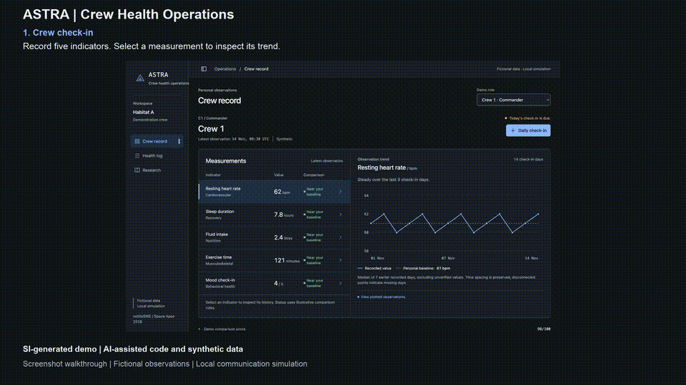

# ASTRA — 28-second project demonstration

Team **notttsSWE** — Yash Kumar and Pawan Krishnamoorthy.

[Watch or download the MP4 video](astra-demo.mp4?raw=true). No account or permission request is needed.

This is a captioned screenshot walkthrough of the working prototype, rather than a recording of live clicks. It runs for **28 seconds**, including the introduction and closing credits. The MP4 is 1920×1080, H.264, with no audio; captions carry the explanation. The GIF repeats the same walkthrough for viewing on GitHub.

- **0–8 seconds:** crew record, five manually entered indicators and a selectable trend.
- **8–15 seconds:** medical-officer review queue and selected crew record.
- **15–22 seconds:** fixed received ground snapshot and saved review note.
- **22–28 seconds:** team, NASA resource use, implementation and prototype boundaries.

**AI/SI disclosure:** AI assistance was used for code, synthetic scenarios, research synthesis, interface design, writing and preparation of this video. A visible SI-generated disclosure is included throughout the video and GIF. The source screenshots show our application; no generated NASA logos, flags or mission identifiers appear.

All observations are fictional. Ground communication and role switching are local simulations; there is no real Earth-space transmission, live telemetry, diagnosis or clinical validation.

## NASA resources used

NASA Human Research Program resources inform the educational context and body-system explanations. They do not establish or validate the numerical demonstration thresholds.

- [Five Hazards of Human Spaceflight](https://www.nasa.gov/hrp/hazards/)
- [Risks of Human Spaceflight](https://www.nasa.gov/hrp/risks/)
- [Ongoing Human Research Program Research](https://www.nasa.gov/hrp/ongoing-hrp-research/)

## Code and attribution

[Open the project and setup instructions](../../README.md). [Submission text and full attribution](../../SUBMISSION.md).

The video uses screenshots captured during browser verification and FFmpeg for scaling, captions and encoding. The GIF derives from that MP4. There is no music, voice, stock imagery or real health data. The first crew capture predates minor typography adjustments; the underlying workflows match the submitted code.
